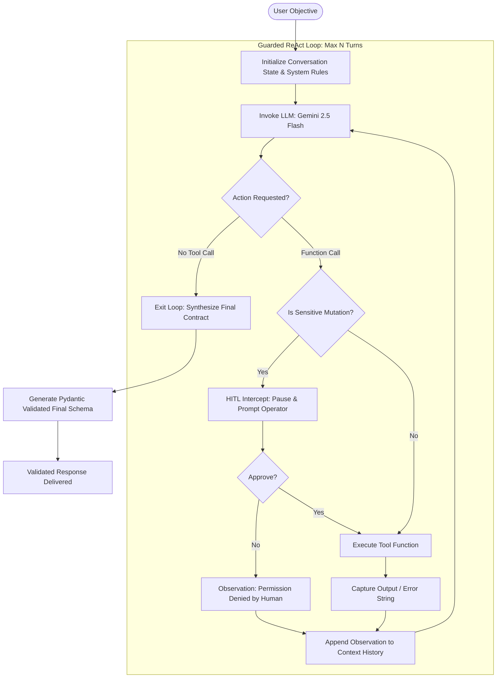

# Deterministic Agentic AI: Guarded Workflows, SQL Agents & HITL Control

A lightweight, production-grade Agentic AI runtime built in native Python, PostgreSQL, and Google GenAI SDK. 

This repository implements the **ReAct (Reasoning + Acting)** pattern from first principles, specifically addressing the three critical failure modes of autonomous LLMs: **infinite execution loops**, **tool hallucination / schema drift**, and **unmonitored database mutations**.

---

## Architectural Problems Solved

1. **Unbounded Execution (Loop Burn):** Unconstrained while-loops burn API token quotas when an LLM repeats failing tool calls. This runtime enforces a strict turn-budget state machine with termination guards.
2. **Runtime Exceptions from Tool Hallucination:** Naive function calling crashes when models pass hallucinated arguments or bad types. All tool payloads pass through Pydantic schemas, and execution errors are returned to the conversation as observations for self-correction.
3. **The Text-to-SQL Trap:** Generating raw SQL from prompts causes syntax mismatches and severe security vulnerabilities (`DROP`, `DELETE`). This engine implements schema introspection via `information_schema`, a token-level `SELECT`-only guard, and database error trapping.
4. **Unsupervised Mutation Risk:** Autonomous agents must not write to production tables unmonitored. High-risk write operations are governed by a **Human-in-the-Loop (HITL)** intercept gate.

---

## Agent State Machine & Execution Flow



---

## Project Structure

```text
.
├── react_engine.py      # Milestone 1: Baseline ReAct loop with conversation state
├── agent_guardrails.py  # Milestone 2: Pydantic input/output contracts & defensive dispatch
├── seed_agent_db.py     # Database migration: corporate transactions fixture
├── agent_sql.py         # Milestone 3: Self-correcting Text-to-SQL agent with schema inspection
├── agent_hitl.py        # Milestone 4: Full HITL state machine with mutation intercept
├── requirements.txt     # Pinned production dependencies
├── .gitignore           # Environment & cache exclusion rules
└── README.md            # System architecture & documentation
```

---

## Component Deep Dive

### 1. Schema Introspection & Security Boundary (`agent_sql.py`)
Rather than guessing table structures, the agent inspects the database at runtime:
* `describe_table`: Queries `information_schema.columns` to dynamically bind column names and data types into context.
* `execute_readonly_sql`: Rejects any statement containing forbidden tokens (`DROP`, `DELETE`, `TRUNCATE`, `ALTER`, `UPDATE`, `INSERT`, `GRANT`) and verifies the query starts with `SELECT`.
* **Error Self-Correction:** When PostgreSQL throws a syntax exception, `psycopg.Error` is captured and returned as an observation, allowing the model to rewrite its query on the subsequent turn.

### 2. Human-in-the-Loop (HITL) Intercept Gate (`agent_hitl.py`)
Tools are split into two security tiers:
* **Autonomous Tier:** Read-only queries and schema lookups execute immediately.
* **Sensitive Mutation Tier:** Functions like `flag_transaction_for_audit` halt execution, display the exact JSON payload in the host terminal, and demand explicit operator confirmation before committing transactions to PostgreSQL.

### 3. Structured Termination Contracts
When the agent concludes its reasoning turns, it runs a final structured synthesis turn bound to strict Pydantic models (`DatabaseAuditReport`, `HITLFinalSummary`), guaranteeing typed outputs for downstream microservices.

---

## Getting Started

### 1. Prerequisites
* Python 3.10+
* Docker running PostgreSQL 16 (`pgvector/pgvector:pg16` on port `5432`)
* Gemini API Key

### 2. Install Dependencies
```powershell
pip install google-genai pydantic psycopg[binary]
```

### 3. Seed PostgreSQL Database
```powershell
python seed_agent_db.py
```

### 4. Run the Implementations
```powershell
# Set API Key
$env:GEMINI_API_KEY="your-api-key-here"

# 1. Baseline ReAct Loop
python react_engine.py

# 2. Guarded Pydantic Agent
python agent_guardrails.py

# 3. Autonomous SQL Agent
python agent_sql.py

# 4. Human-in-the-Loop Mutation Agent
python agent_hitl.py
```